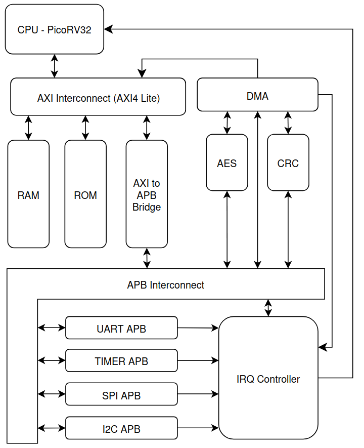

# Aquila-I

Aquila-I is a 32-bit RISC-V SoC built around PicoRV32. It integrates an AXI4-Lite interconnect, an AXI-to-APB bridge, shared SRAM, a DMA engine, and hardware accelerators for AES-128 and CRC32. The SoC was implemented on SKY130 as part of a graduation thesis.



## IP credits

Thanks to the authors and maintainers of the cores used in Aquila-I:

- **CPU:** [PicoRV32](https://github.com/YosysHQ/picorv32) by Claire Xenia Wolf.
- **I²C:** The master core and AXI-Stream FIFO from Alex Forencich's [verilog-i2c](https://github.com/alexforencich/verilog-i2c).
- **SPI:** The master core adapted from Russell Merrick's [Nandland SPI Master](https://github.com/nandland/spi-master).
- **UART:** The UART core, RX, and TX modules adapted from Alex Forencich's [verilog-uart](https://github.com/alexforencich/verilog-uart).

Aquila-I integrates the serial cores behind APB register interfaces. The thesis layout also uses a [VLSIDA SKY130 SRAM macro](https://github.com/VLSIDA/sky130_sram_macros). See [third-party notices](docs/third-party.md) for the source files and license terms.

## Run the RTL regression

On Linux, install GNU Make, Python 3, Icarus Verilog (including `vvp`), and the bare-metal RISC-V GCC and binutils. The default cross-tool prefix is `riscv64-unknown-elf-`. Set `RISCV_PREFIX` when using a differently named toolchain with RV32I/ILP32 support.

```sh
make test
```

The command builds the firmware, generates the 8 KiB simulation ROM, and runs a self-checking RTL testbench. A successful run prints `AQUILA-I RTL PASS` and exits with status 0. A CPU trap, firmware error, failed I²C ACK check, or timeout exits with a nonzero status. With Icarus Verilog 12.0 and RISC-V GCC 14.2.0, the completion marker arrived after about 7.80 ms of simulated time.

- `make fw` builds the firmware and generated ROM in `build/`.
- `make test VVP_ARGS=+waves` also writes `build/soc.vcd` for GTKWave.
- `make test VVP_ARGS=+max_cycles=50` exercises the watchdog and is expected to fail.

## Architecture

PicoRV32 executes RV32I firmware and configures the peripherals over APB. The AXI4-Lite interconnect handles single-beat transactions and gives the CPU priority when both masters request an idle channel. Once granted, a transaction completes before another master takes over. DMA bus accesses are restricted to SRAM. The accelerators exchange data with DMA over dedicated interfaces.

| Base address | Block |
| --- | --- |
| `0x0000_0000` | Boot ROM |
| `0x0001_0000` | Shared 2 KiB SRAM |
| `0x4000_0000` | UART |
| `0x4000_1000` | Timer |
| `0x4000_2000` | SPI master |
| `0x4000_3000` | I²C master |
| `0x4000_4000` | Interrupt controller |
| `0x4000_5000` | DMA |
| `0x4000_6000` | CRC32 |
| `0x4000_7000` | AES-128 |

DMA supports SRAM copies, SRAM-to-CRC transfers, CRC result writeback, and AES transfers with SRAM writeback. The AES control register selects encryption or decryption. The RTL interconnect decodes a 4 KiB SRAM window, and the upper 2 KiB mirrors the lower 2 KiB because the SRAM wrapper indexes 512 words. Firmware and register offsets are in [firmware/main.c](firmware/main.c).

## Verification status

| Check | Result and source |
| --- | --- |
| RTL firmware regression | Reproducible with `make test`. Covers UART output, timer IRQ, SPI loopback, a single-byte I²C write, DMA copies, CRC32, AES encryption/decryption, DMA completion IRQ, and invalid DMA configurations. |
| Hierarchical SKY130 implementation | Completed in the thesis run. The reported die area was 4.674 mm². |
| Post-layout GLS | The thesis run recorded PASS for ROM boot/UART output and one AES-128 vector in both directions, at zero delay and at 18 ns with SDF maximum delays. |
| Timing and layout | The thesis reports setup/hold met for constrained top-level paths at 18 ns, zero DRC/LVS errors, and remaining electrical and antenna violations. |

See [verification and physical results](docs/verification.md) for the scope, recorded waveforms, and limits on reproducing the thesis run.

The [thesis excerpt (Vietnamese PDF)](docs/thesis-chapters-3-4-vi.pdf) contains Chapters 3 and 4, covering the SoC design, verification, and physical implementation.

## License

The [MIT license](LICENSE) applies to Aquila-I's original code. Upstream components retain the terms in [third-party notices](docs/third-party.md). The thesis excerpt and figures retain their original rights and are outside the scope of the MIT code license.
