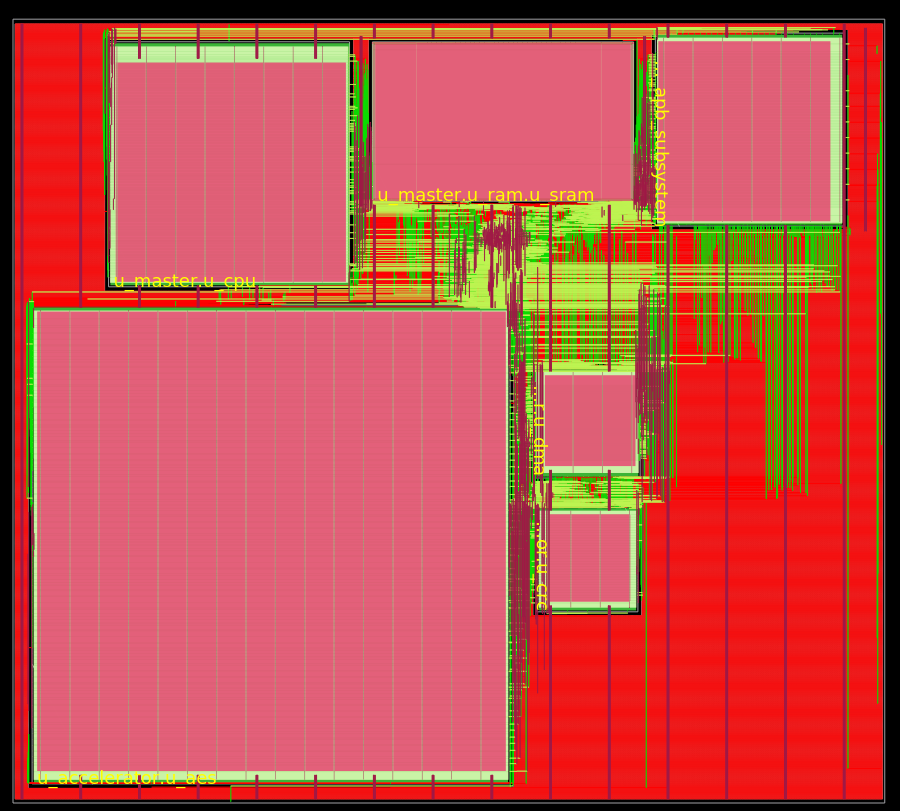
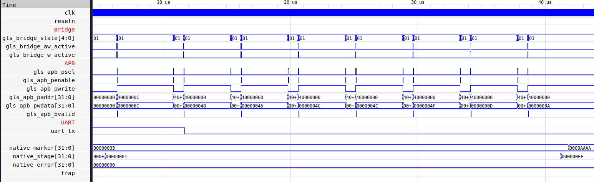
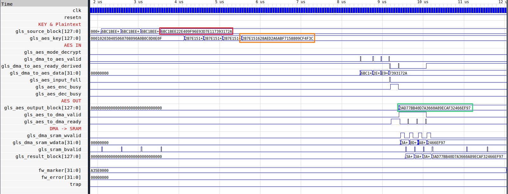
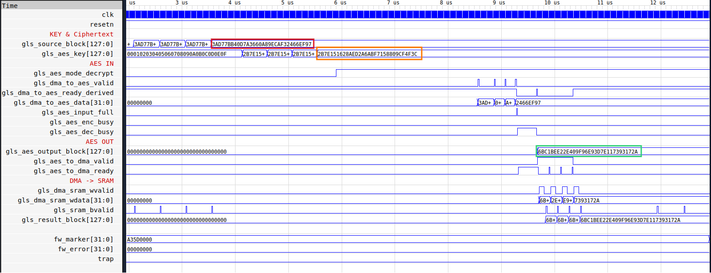

# Verification and physical results

## RTL regression

`make test` builds an RV32I firmware image and runs it on the SoC. The testbench checks the SRAM completion marker (`0x0000AAAA`), the firmware stage (`0xFF`), and a zero firmware failure code. It additionally checks for an acknowledged I²C write because the firmware can also finish after reporting a NACK. The watchdog and CPU trap monitor make a failed run visible to the caller through the simulator exit status.

| Group | Scenario |
| --- | --- |
| Boot and peripherals | ROM boot and UART output, timer operation and timer IRQ, SPI MOSI-to-MISO loopback, and one I²C write with a behavioral ACK responder |
| DMA and CRC32 | SRAM-to-SRAM copy, DMA input to CRC32, APB readback, and DMA writeback of the CRC result |
| AES-128 | Two known-answer blocks through DMA-to-AES for encryption and decryption, with results written back to SRAM |
| DMA status and errors | Completion interrupt and invalid length/configuration paths |

The RTL test uses a 10 ns test clock, an 8 KiB generated ROM, and the functional SRAM model in [tb/sram_model.v](../tb/sram_model.v). The test exercises selected behavior at the RTL level. The physical design used a 1 KiB boot ROM.

## Hierarchical SKY130 implementation

The thesis implementation used OpenLane/OpenROAD. The top integrates five logic hard macros (PicoRV32, APB subsystem, DMA, AES-128, and CRC32) and one SRAM macro. The following values are transcribed from the final thesis, Chapter 4, Table 4.14 and its accompanying text.



| Metric | Reported result |
| --- | --- |
| Die dimensions and area | 2.280 × 2.050 mm, 4.674 mm² |
| Top-level STA clock constraint | 18 ns |
| Worst setup slack across reported RC corners | +8.80 ns at RC max |
| Worst hold slack across reported RC corners | +0.11 ns at RC min |
| Final DRC / LVS | 0 violations / 0 errors |
| Top-level electrical violations (slew / fanout / capacitance) | 9 / 77 / 0 at typical, 160 / 77 / 1 at RC max |
| Antenna violations | 84 pins across 66 nets |

The STA result covers the constrained paths at the integration level. The thesis identifies nine external output endpoints with incomplete constraints. The 18 ns period is an STA condition. The final layout still had electrical and antenna violations. This repository reproduces the RTL regression. The complete inputs needed to rerun hierarchical place and route and SDF GLS are outside its scope.

## Post-layout gate-level simulation

The thesis used routed top and leaf netlists. OSS CVC 7.00b annotated top-level SDF and the PicoRV32, APB, DMA, and AES leaf SDFs at `+maxdelays`. The simulations used the functional SRAM model available for the thesis run. CRC32 leaf timing and SRAM macro timing were outside the SDF test scope. A simulation copy omitted leaf-output interconnect records that CVC could not map. The top-level interconnect and supported internal delays remained annotated.

| Scenario | Zero delay | SDF maximum delays at 18 ns |
| --- | --- | --- |
| Native ROM boot and UART | PASS | PASS, UART `HELLO` |
| DMA–AES-128 encryption to SRAM | PASS | PASS, ciphertext matched |
| DMA–AES-128 decryption to SRAM | PASS | PASS, plaintext matched |

The native test ran the firmware baked into the netlist. The AES tests used a testbench overlay only on ROM read data to load compact firmware. CPU execution, bus transactions, accelerator processing, and SRAM writes ran through the routed design. CVC reported no dynamic timing violations for these three runs. STA remains the source of the timing closure assessment.

Selected lines from the saved SDF simulation logs:

```text
[1092649000] UART_LINE_HEX: 0x48454c4c4f
[1092663000] NATIVE_GLS_PASS
[12051000] AES_ENC_GLS_PASS
[12915000] AES_DEC_GLS_PASS
```






